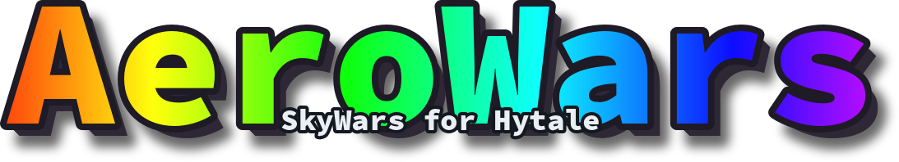

<p align="center">
  
</p>

<p align="center">
  <b>A competitive SkyWars-style minigame for Hytale.</b><br>
  Multi-arena Solo &amp; Teams, spawn cages, chest loot tables, selectable kits, spectator mode, cosmetics, parties &amp; matchmaking, and a fully custom UI/HUD.
</p>

<p align="center">
  <a href="https://stoshelabs.github.io/aerowars/"></a>
  
  =0.6.0 <0.7.0">
  
</p>

<p align="center">
  
  
  
</p>

<p align="center">
  📖 <b><a href="https://stoshelabs.github.io/aerowars/">Read the full documentation →</a></b>
</p>

---

## Overview

AeroWars drops each player (or team) onto a floating island. Grab loot from island and middle chests, gear
up, and be the last one standing. Matches run in isolated, disposable worlds cloned from map templates, so
any number of games can run at once without touching your main world.

- **Solo (FFA)** and **co-op Teams** arenas, with configurable team size
- **Maps are first-class** — build a map once and reuse it across many arenas, optionally with a random map pool
- **Prefab spawn cages** that hold players during the countdown, then drop away on start
- **Weighted chest loot** (island / middle tiers) with a unified, scheduleable **events** system
- **Selectable kits** — pick before the match, or build them visually in the admin panel
- **Spectator mode** on Hytale's native spectator, **parties &amp; matchmaking queues**, and **cosmetics** (cage themes, kill effects, victory shows, trails)
- **Stats &amp; leaderboards**, **economy rewards**, **PlaceholderAPI**, and **TaleGuard** protection

---

## Quick start

1. Drop `AeroWars-<version>-hytale-<line>.jar` into your server's `mods/` folder — the `hytale-` part is the game line the build targets, so pick the one matching your server (e.g. `-hytale-0.6` for any 0.6.x). Requires a Hytale server in the `>=0.6.0 <0.7.0` range (still on 0.5.x? use AeroWars 1.1.0).
2. Start the server once to generate the config, language, loot, kit, and cage files.
3. Build your first arena:

```text
/aerowars world create skyisland      # make a void template world and build your map in it
/aerowars setup start skyisland       # run the setup wizard (spawns, chests, spectator)
/aerowars setup save                  # save the map
/aerowars arena create arena1 skyisland solo   # turn the map into a playable arena
/aerowars setlobby                    # set where players return after a match
```

Then `/aerowars join` (or `/sw join`) to play. The **[Getting Started](https://stoshelabs.github.io/aerowars/guide/intro/getting-started)** guide covers this in full.

---

## Documentation

Everything lives on the docs site — commands, config, and integrations, with one version of the docs per release line (pick yours from the version menu):

| | |
| --- | --- |
| 🚀 [Getting Started](https://stoshelabs.github.io/aerowars/guide/intro/getting-started) | Install to first playable arena |
| 🏝️ [Maps &amp; Arenas](https://stoshelabs.github.io/aerowars/guide/features/maps-arenas) · [Cages](https://stoshelabs.github.io/aerowars/guide/features/cages) | Build maps, create arenas, random pools, prefab cages |
| ⚔️ [Match Flow](https://stoshelabs.github.io/aerowars/guide/features/match-flow) · [Kits](https://stoshelabs.github.io/aerowars/guide/features/kits) · [Spectating](https://stoshelabs.github.io/aerowars/guide/features/spectating) · [Parties &amp; Queues](https://stoshelabs.github.io/aerowars/guide/features/parties-queues) · [Cosmetics](https://stoshelabs.github.io/aerowars/guide/features/cosmetics) | Gameplay |
| ⚙️ [Config Reference](https://stoshelabs.github.io/aerowars/guide/setup/config) · [Loot &amp; Events](https://stoshelabs.github.io/aerowars/guide/setup/loot-events) | Configuration |
| 🔌 [Economy](https://stoshelabs.github.io/aerowars/guide/integrations/economy) · [PlaceholderAPI](https://stoshelabs.github.io/aerowars/guide/integrations/placeholders) · [TaleGuard](https://stoshelabs.github.io/aerowars/guide/integrations/taleguard) | Integrations |
| 📖 [Commands](https://stoshelabs.github.io/aerowars/guide/reference/commands) · [Permissions](https://stoshelabs.github.io/aerowars/guide/reference/permissions) · [Placeholders](https://stoshelabs.github.io/aerowars/guide/reference/placeholders) | Reference |
| 📝 [Changelog](https://stoshelabs.github.io/aerowars/guide/changelog) | What changed in each release, and which Hytale version each targets |

---

## Building from source

```sh
./gradlew jar        # → build/libs/AeroWars-<version>-hytale-<line>.jar (line read from the HytaleServer.jar it compiles against)
```

The build locates `HytaleServer.jar` from your Hytale install (or `libs/`). The docs live in [`docs/`](docs) (VitePress) and deploy to GitHub Pages automatically on push to `main` — one directory per release line, built by [`tools/build_docs.sh`](tools/build_docs.sh). See [`RELEASING.md`](RELEASING.md) for cutting a release.

---

<sub>Built for Hytale. Optional companions: <a href="https://placeholderapi.com">PlaceholderAPI</a> &amp; <a href="https://github.com/stoshelabs/taleguard">TaleGuard</a>.</sub>
